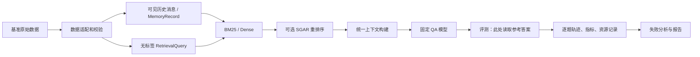

# 架构与接口设计

## 设计原则

数据适配、检索、问答、评测和分析分离；所有方法走同一个 runner、上下文构建、QA 和评测路径。元数据方法只改变候选重排序，先以失败分析确定需要的特征。以下为目标结构，按实际任务逐步创建，不预先添加空实现。

```text
sgmem/
├── README.md  CONTRIBUTING.md  pyproject.toml  .gitignore
├── configs/                 # 数据、模型、检索、实验与资源配置
├── src/sgmem/
│   ├── datasets/            # 上游适配、验证、split
│   ├── memory/              # 记录模型、关系索引
│   ├── retrieval/           # BM25、dense、SGAR，统一接口
│   ├── llm/                 # 本地推理、prompt、answer/judge
│   ├── evaluation/          # runner、指标、基准评测适配、轨迹
│   ├── profiling/           # 阶段耗时、资源和 token 测量
│   └── analysis/            # 失败归因、配对比较、表格
├── tests/                   # 合同、数据泄漏、集成等测试
├── scripts/                 # 薄入口；复用 src 逻辑
├── docs/                    # 设计、协议、实验及面试说明
├── data/                    # 原始及处理数据，默认不入 Git
├── external/                # 固定提交的官方基准子模块
│   ├── GroupMemBench/
│   └── EverMemBench/
├── results/                 # 运行产物，默认不入 Git
├── report/                  # 报告源文件和精选图表
└── poster/                  # 海报源文件
```

仓库内保留人工编写的配置、最小合成测试样例和生成图表的脚本。大型下载、缓存及原始轨迹单独存储；详见[数据管理](data-and-dependencies.md)。待首条端到端流程确定后再锁定依赖，避免将占位脚本误认为可运行功能。

## 数据流与责任



`datasets` 将上游消息映射成统一记录，保留原始 ID 与数据集/领域命名空间；记录的 speaker、group、timestamp、reply 等未知时明确为 null，不能凭空填值。`memory` 维护 ID 和回复关系，处理悬空引用；`retrieval` 返回有序候选和可解释分数；`llm` 构建一致上下文并生成回答；`evaluation` 唯一持有参考答案及评测标签；`analysis` 消费冻结的轨迹，不能反向影响 test 配置。

## 首批共享契约（设计草案）

数据和检索负责人先用小规模真实样例核对字段与上游规则，再通过契约 PR 冻结版本；以下并非声称已实现：

- `MemoryRecord`：数据集、领域、稳定 `message_id`、`content`、可选 `speaker_id`、`group_id`、`timestamp`、`reply_to_id` 和来源信息。消息 ID 在命名空间内唯一；字段缺失和时间格式须明确处理。
- `RetrievalQuery`：`question_id`、查询文本、推理时公开的查询上下文及适用的时间截止；**不包含答案、标注证据、正确 group 或评测标签**。具体公开字段依据上游任务定义核定，不能把真实答案推导的线索注入查询。
- `RetrievalResult`：有序 message ID、原始检索分数、最终排序分数及可选特征分量；分数方向、归一化、并列排序与缺失值处理必须写入配置。所有方法保存同等可追踪的信息。
- `Retriever`：对同一可见消息集合构建/加载索引，接收 `RetrievalQuery` 与 `top_k` 返回 `RetrievalResult`。SGAR 包装基座检索器，候选池 M、最终 K、特征和权重均配置化；不允许从答案或证据标签生成特征。
- `RunRecord`：固定配置、代码/数据/模型版本、执行环境与分割清单标识，加逐题候选、预测、评价、错误与资源记录。字段保持清晰一致，并按 `question_id` 连接。

对于有时间或可见性约束的任务，数据适配器应按上游规定限制每题可检索的历史；不能默认所有消息对每个问题都可见。方法评测隔离还需覆盖 future-message、参考答案、证据 ID 和正确群组泄漏。

## 技术取舍

SGAR 的预期形式是对基座前 M 个候选的内容分数与 speaker/group/reply/time 信号做加权，然后取 K。目标人物与群组只能从公开查询信息及可见候选推断；多参与者问题不应仅筛选提问者。时间新并不必然代表事实更新，回复链也不自动证明因果或修正。权重只在 dev 选取，做单特征消融并公开失败情形。固定数量特征且已建立索引时，重排序评分为 O(M)、全排序为 O(M log M)；这不包含基础检索、建索引或邻居扩展。

GroupMemBench 官方评测流程须通过固定版本的适配器核对；本地替换 QA/embedding 模型后的结果称为本地基线，不称为官方模型配置的精确复现。外部系统先作为参考，不集成复杂图系统，除非基线分析说明必要。
