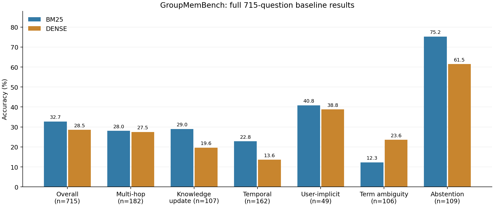
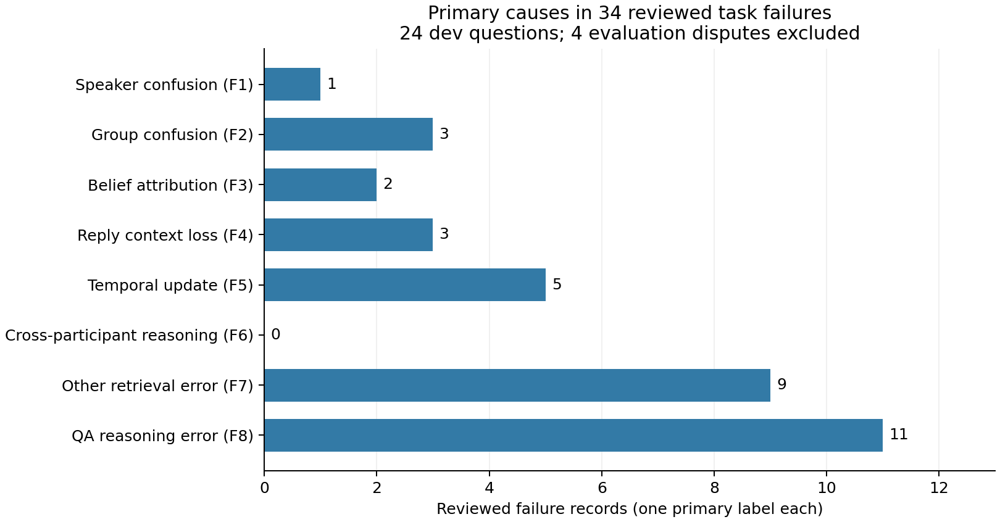

# Part 1 / Part 2：全量基线结果与结构性错误分析

日期：2026-11-05。主运行 `part1-full-20261105`，并行汇总 `part1-full-20261105-parallel/combined`。

## 完成判断与适用范围

**Part 1 的双基线全量实验和 Part 2 的错误分类、分布、案例及元数据诊断已实质完成，可以交给队友继续做 Part 3。** 这里的完成指已经有可运行实现、真实结果与可追溯分析，不代表课程最终提交或分数保证。错误标注由 Codex 逐条核对源消息后形成，明确标记为 **AI-assisted source review**，没有冒充人工专家金标；建议队友优先复核四条争议记录。

依据课程最终项目 PDF 第 44–46 页：Part 1 要求 BM25、Dense 及总体/六类准确率；Part 2 要求失败分类、分布、代表案例以及 speaker/group/time/reply 的潜在作用。PDF SHA256 为 `709b38ae78f94e51ec362257eb1d03e9f97de8baf2613e09d24351a852e69028`。课程明确允许本地 Qwen 4B–8B 和 E5。本文是官方流程的本地模型适配，不能作为上游 GPT-5 / text-embedding-3-large 配置的精确复现。

| 要求 | 本次可检查的交付 |
|---|---|
| Part 1：两种内容检索基线 | BM25、E5-small-v2；四域各自完整 30,000 条历史消息 |
| 官方评测流程与六类指标 | 同一 Qwen3-8B、官方 QA/judge 提示与判定规则；两法各 715 题 |
| Part 2：失败分类与分布 | 九类 taxonomy；固定开发样本中的 38 条判错记录全部有解释与源消息 ID |
| 代表案例与结构作用 | 24 道成对案例、61 条源消息；回复图可达性诊断及适用边界 |
| 可复查与资源记录 | 1,430 条精简结果、固定划分、指标、成本、原始压缩证据、无 GPU 核验入口 |
| 尚未完成 | Part 3 的实际修复方法与消融；Part 4 的最终约 6 页报告、海报/演示及个人代码面试准备 |

## 固定实验设置与完整性

- GroupMemBench 固定提交：`461f00c3e8a1a4a3a2ed5814b729014502c4702f`。
- QA/judge 均为已有 Qwen3-8B，revision `b968826d9c46dd6066d109eabc6255188de91218`；Dense 为 E5-small-v2，revision `ffb93f3bd4047442299a41ebb6fa998a38507c52`。
- 每题 top-10；内容检索后附加说话人、角色、群组、时间、回复等元数据，没有实现 Part 3 重排。
- BF16、SDPA、非 thinking、temperature 0.2、top-p 1、top-k 0；每次生成固定种子 42；回答/判分输出预算 512/256 token。
- dev 179 题、test 536 题，按问题分层；两者共享对话语料，不代表跨对话泛化。Part 2 只查看 dev 案例，test 仅做冻结基线的数值汇总。
- BM25 执行提交 `1948e642400006e9abf31a27750d8048be62e082`；Dense 分片执行提交 `0c0ee203d297b75e8913923f0036ef4c5a73709e`。合并核对了数据、模型、环境、检索/QA/runner 代码和生成实现一致，差异仅是调度。

完整模型、数据、软件、源码和运行来源见 [provenance.json](evidence/part12-full-20261105/provenance.json)。

两个方法各有 715 个唯一题目，无缺题、重复或跨分片重叠；原始分片与合并记录逐字段一致。2,860 次调用正好对应 1,430 次回答和 1,430 次判分，没有多计重试。两法均为 0 调用错误、0 无法解析判分、0 judge 截断。

BM25 有 5/715 条、Dense 有 10/715 条回答到达输出上限，均已按原始输出判错并保留标记，没有重新生成或改分。即使这些题全部修复，准确率最多分别增加 0.70、1.40 个百分点，因此截断不足以解释总体低分。QA 输入最大分别为 2,330、2,362 token；使用相同模型上下文上限，没有静默截断输入。不同检索内容的实际输入 token 数自然不同，并未强行补齐成相同长度。

## Part 1 结果

| 题型 | 题数 | BM25 正确/总数 | BM25 准确率 | Dense 正确/总数 | Dense 准确率 |
|---|---:|---:|---:|---:|---:|
| Multi-hop | 182 | 51/182 | 28.02% | 50/182 | 27.47% |
| Knowledge update | 107 | 31/107 | 28.97% | 21/107 | 19.63% |
| Temporal | 162 | 37/162 | 22.84% | 22/162 | 13.58% |
| User-implicit | 49 | 20/49 | 40.82% | 19/49 | 38.78% |
| Term ambiguity | 106 | 13/106 | 12.26% | 25/106 | 23.58% |
| Abstention | 109 | 82/109 | 75.23% | 67/109 | 61.47% |
| **全部** | **715** | **234/715** | **32.73%** | **204/715** | **28.53%** |



| 范围 | BM25 | Dense |
|---|---:|---:|
| Finance，214 题 | 79/214，36.92% | 71/214，33.18% |
| Technology，213 题 | 70/213，32.86% | 58/213，27.23% |
| Healthcare，130 题 | 33/130，25.38% | 37/130，28.46% |
| Manufacturing，158 题 | 52/158，32.91% | 38/158，24.05% |
| Dev，179 题 | 56/179，31.28% | 58/179，32.40% |
| Test，536 题 | 178/536，33.21% | 146/536，27.24% |

**完整结果不支持沿用早期 12 题试跑中“Dense 明显更好”的判断。** 全量 BM25 高 4.20 个百分点，但 Dense 在术语歧义上高 11.32 个百分点，在 Healthcare 也略高。Dev 两法仅差 2 题，不能依据已经看到的 test 结果继续调参或选后续方法；保留两条基线，后续方法选择仍限于 dev。

成对比较中，两法都正确 122 题、仅 BM25 正确 112 题、仅 Dense 正确 82 题、两法都错 399 题。对全体问题，BM25−Dense 的成对 bootstrap 95% 区间为 **[+0.28, +7.97] 个百分点**，McNemar 双侧精确 p=0.0371；test-only 差值为 +5.97 个百分点，区间 [+1.68, +10.07]，p=0.00718。计算采用 20,000 次抽样、种子 42。由于多题共享对话及问题家族，这些是问题级的描述性不确定性，不应包装成跨数据集或独立对话上的强显著性结论。

## Part 2 抽样与分类规则

先固定抽样规则，再阅读案例：对每个“领域 × 题型”格，从 **dev 中至少一条基线失败的题目**中按固定盐值的 SHA256 顺序取一题；得到 24 道题、48 条成对记录，其中 38 条被 judge 判错。样本包含 BM25 21 条、Dense 17 条判错记录。全部 38 条均核对了检索结果、回答和原始消息，完整标注见 [failure-annotations.jsonl](evidence/part12-full-20261105/failure-annotations.jsonl)。

抽样属于覆盖领域/题型的配额诊断，不能把样本百分比外推到全部 992 条全量失败。开发集共有 244 条失败，本次详查 38 条，其余 206 条未逐条归因。此前 pilot 的 17 条标注不重复并入本分布；其中同一道题如被本次规则选中，按本次完整轨迹重新核查。

标签根据来源和模型行为确定，不直接把 temporal 题标成 F5，或把 multi-hop 题标成 F6。允许次级标签，但主标签只有一个。四条 F9 只表示需要复核的评测/参考答案争议，单列且不改原始分数。

| 主标签 | 含义与判定重点 | 本次条数 |
|---|---|---:|
| F1 | 说话人或角色目标错误；区别提问者与被问的人 | 1 |
| F2 | 另一群组/项目的规则被应用到当前问题 | 3 |
| F3 | 别人的观点或优先事项被当作提问者自己的 | 2 |
| F4 | 检索到讨论节点但丢失有关键结论的回复关系 | 3 |
| F5 | 具体更新未召回，或新旧信息都在但仍采用旧版本 | 5 |
| F6 | 多参与者信息需要组合但未完成组合 | 0 |
| F7 | 其他关键证据召回不足 | 9 |
| F8 | 证据已有但推理、归属、日期换算或拒答判断错误 | 11 |
| **任务错误小计** | 暂定的任务错误；不是人工专家金标 | **34** |
| F9 | 判分过严、参考状态或问题语义有争议，待复核 | 4 |



F6 本轮没有足够证据确认，不为凑齐分类强行填例。主标签中 14 条属于 F1–F5 的结构相关问题，但这不意味着其中 14 条都能仅靠检索重排修复；例如已有更新仍被忽略的情况发生在 QA 阶段。

## 有代表性的证据与判断

以下 ID 都以领域为命名空间；不同领域的同名 Msg 不可混用。源消息原文和元数据可从 [source-references.jsonl](evidence/part12-full-20261105/source-references.jsonl) 核查。

1. **不能把提问者当作目标人物。** Healthcare/multi_hop_48 问 Health IT Specialist 对 demand forecasting 字段的要求。BM25 在推理中把 User_3 当作该角色，但所引 Msg_24003 标的是 Nurse Leader；真正相关的 Msg_24002 属于 Health IT Specialist User_4，要求立即验证并冻结 field map。Dense 虽找到了另一个 Health IT Specialist，却使用 Clinical Trial 的 EHR/registry 映射来回答 Supply Chain 问题。需要同时识别人和项目，单独按 role 匹配也会错。

2. **相同角色不等于同一个人的观点。** Manufacturing/user_implicit_3 的 “I” 是 User_3，其 Msg_1645 关注 floor reality vs assumed coverage。Dense 回答 comms checks slipping after install，实际上来自 User_4 的 Msg_20927。两人都可能显示 Production Manager，因此 speaker ID 不能被角色名称替代。

3. **回复链具有可直接验证的价值。** Technology/multi_hop_2 的 BM25 top-1 Msg_638 在问 stale availability 如何处理；Msg_832 回复 degraded-state 方案；Msg_847 再提出 single fallback rule。两步回复链是 `638 → 832 → 847`。Manufacturing/multi_hop_24 中，已召回 Msg_2304 与正确的 controls-trends 建议 Msg_29329 共同回复 Msg_8；只看独立片段会停在泛化的 source alignment。

4. **时间错误有两种不同原因。** Healthcare/user_implicit_1 中 Dense 回答同一 User_2 在 7 月 12 日提出的 portal authentication，却漏掉 7 月 17 日 Msg_26630 更新后的 after-hours support open item，属于更新召回不足。Manufacturing/knowledge_update_10 则已把 7 月 31 日 Msg_1633 放在第 2 条，模型仍使用 7 月 29 日 logging-only 的旧方案；更好的检索位置未必足够。

5. **仅重排无法保证解决日期换算。** Finance/temporal_21 的 Msg_8383 已带 2025-07-13 时间戳并说 today；Technology/temporal_2 的 Msg_6810 已带周三 2025-07-23 时间戳并说 by Friday。BM25 两题都说没有明确日期。这里应识别 QA 未使用已有时间信息，而不是宣称缺少相关消息。

6. **拒答失败常是关系推断过头。** Healthcare/abstention_1 的 Msg_20935 只说需要作出决定，Dense 却把发言者 User_6 指定为决策人。Manufacturing/abstention_6 中，两法都把“Data Engineering 被要求发布 owner”解释成“Data Engineering 就是 owner”。这些材料不足以支持该归属。

7. **评测争议不应伪装成方法改进。** Technology/user_implicit_18 的两种回答都包含标准答案，额外三项也来自同一 User_7 的 Msg_20015，但 judge 因超出短参考范围而判错。另两条 F9 是 Finance/abstention_9 的 July 29/Compliance 归属歧义，以及 Manufacturing/term_ambiguity_8 中“请确认”与“已经确认”的状态区别。它们都保留原始判错，只提出复核依据。

## 元数据是否真能找回证据

在有明确正向支持消息的 **28 条失败记录**中，采用人工可读、AI 辅助识别的源消息 ID 作事后定位；不把这些 ID、gold 答案或正确群组输入原检索器。没有正向支持的拒答题和 F9 争议不混入这个分母。

| 诊断范围 | 至少包含一条已识别支持消息的记录数 |
|---|---:|
| 原 top-10 | 6/28 |
| top-10 加一跳回复邻居 | 6/28 |
| top-10 加两跳回复邻居 | 10/28 |

两跳新增触达 4 条记录：Finance/term_ambiguity_43 的 BM25、Manufacturing/multi_hop_24 的两种基线、Technology/multi_hop_2 的 BM25。其余缺失支持的记录并未因两跳扩展自动恢复。这里使用双向 reply-to 邻接（父消息及子回复），一跳/两跳候选总数中位数分别为 21.5/45.5，已经超过原 top-10。

**这是结构可达性诊断，不是 Recall@10、修复成功率或 QA 准确率提升。** 支持消息来自事后核查，并非基准自带穷尽证据金标。后续若做回复扩展，需要限制分支大小并重排回 top-10，再在相同模型和预算下跑 dev；不能直接拿扩展后更多上下文与原 top-10 比较。

对 speaker/group/time 的结论也有边界：明确的 “I/my” 可提供 speaker 线索，但显式询问另一角色时不能默认按 asker 过滤；相同群组内仍有很多泛化进度通知，group-only 不能补回关键决策；timestamp 要结合更新内容和回复语境，不能一律取最新消息。原 top-10 已含正确证据的六条失败也说明，元数据选择之外还存在 QA 能力问题。

## 效率与低分原因

本次全量累计 **3.5907 GPU-hours**，按每张卡实际驻留时间相加，包括模型加载、索引及答题/判分；不等于利用率积分。之前的 pilot 和额外小样本验证另计，因此这里不声称是整个课程项目的总消耗。课程上限为 50 GPU-hours。

| 项目 | BM25 | Dense |
|---|---:|---:|
| 单题检索平均耗时 | 0.1140 s | 0.0134 s |
| 单题 QA 平均耗时 | 5.2274 s | 6.1873 s |
| 单题 judge 平均耗时 | 2.9882 s | 3.3294 s |
| 四域索引总耗时 | 2.58 s | 两 worker 分别 62.44 / 62.17 s |
| 回答生成 token 总数 | 114,660 | 128,329 |
| GPU 驻留消耗 | 1.6581 GPU-h | 两卡合计 1.9326 GPU-h |

GPU 为 RTX A6000。三个进程的 PyTorch 峰值 allocated 显存约 15.82–16.04 GiB，不是整卡显存占用。全量从北京时间 17:50:23 到 19:34:32，约 104 分钟；18:35:52 加卡后约 58 分 40 秒结束。没有额外做完整同配置单卡计时对照，不能把 GPU-hours 与 wall time 的比值当作严格测得的加速比。

Dense 的向量检索本身更快，但其回答更长，QA/judge 也更慢；模型生成占主要成本。两张 Dense 卡各建一次相同领域索引是本次并行的额外开销，成本已计入。后续优先减少无效候选和不必要生成，而不必首先优化毫秒级向量查询。

目前未发现能解释整体低分的系统性管线错误：运行、题目覆盖、官方流程、提示与来源对齐均有审核证据。实际案例已经暴露证据召回不足、角色/观点/群组混淆、日期推理、过度推断及小模型 judge/参考答案争议。这些解释局限于已检查样本，不能把未检查的 206 条 dev 失败或所有 test 失败都归给某一种原因，也不能宣称代码在所有情形下绝无缺陷。

## 复核与复现

仓库内的精简证据约数 MB，不包含模型、完整语料或重复的全量检索正文。无需 GPU，可直接重算表格、抽样和错误分布：

```bash
python scripts/verify_part12_evidence.py
# 初始化固定子模块后，还可逐条核对 61 条源消息及回复图可达性：
python scripts/verify_part12_evidence.py --benchmark external/GroupMemBench
```

从完整原始证据重建表格和图：

```bash
python -m pip install -e '.[analysis]'
python scripts/analyze_full_baselines.py \
  --bundle /path/to/extracted-evidence \
  --archive /path/to/SGMem-Part1-full-evidence-20261105.tar.gz \
  --annotations docs/evidence/part12-full-20261105/failure-annotations.jsonl \
  --output /path/to/new-analysis --plots
```

原始证据压缩包 SHA256：`792a534593ea1957b24ea86b87316e3736b694dadc38f0fdd6ee01711e3cd7b1`，本机与服务器一致。服务器副本为 `/home/ai4s_group/XZG/NLP/sgmem/results/exports/part1-full-20261105-evidence.tar.gz`；本地交接副本名为 `SGMem-Part1-full-evidence-20261105.tar.gz`。其中保留逐题完整回答、judge 输出、检索正文、调用审计、配置、分片来源和交接日志。

原串行入口在 BM25 完成后被计划内中断以避免重复跑 Dense，所以原总配置的 `finished=false` 不是全量合并失败。权威完成标志是并行目录的 `controller.exit=0`、`completion.json` 和最终两法均 `complete=true` 的汇总。金融服务器采用直接 Transformers 环境，未把这次结果标成 Docker 验证。

后续交给队友的优先项是：先复核四条 F9，再在固定 dev 上测试有界两跳回复扩展和谨慎的 speaker/group 重排，并把候选压回 top-10。Part 3 的方法和消融完成前，本文不报告任何修复后的准确率。
